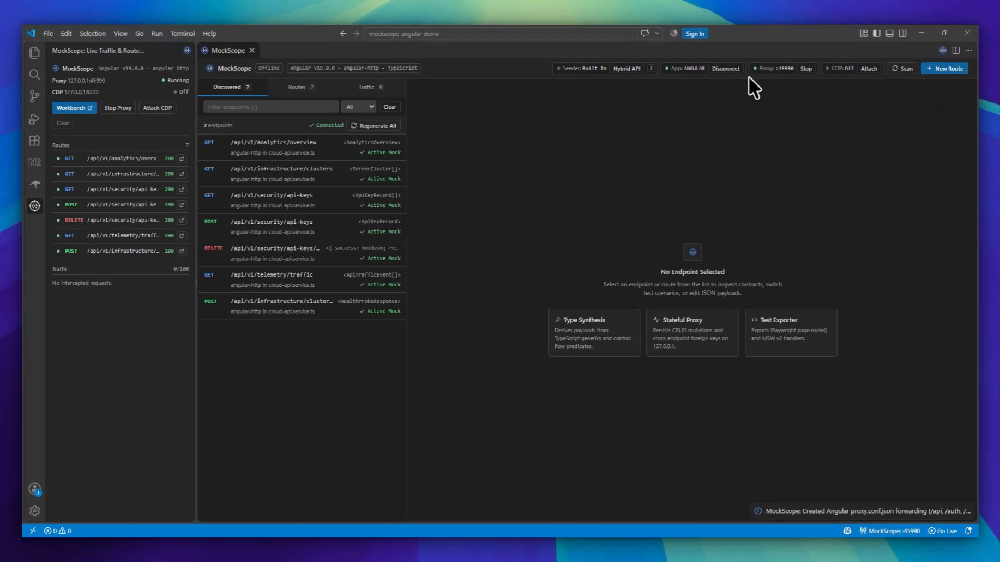
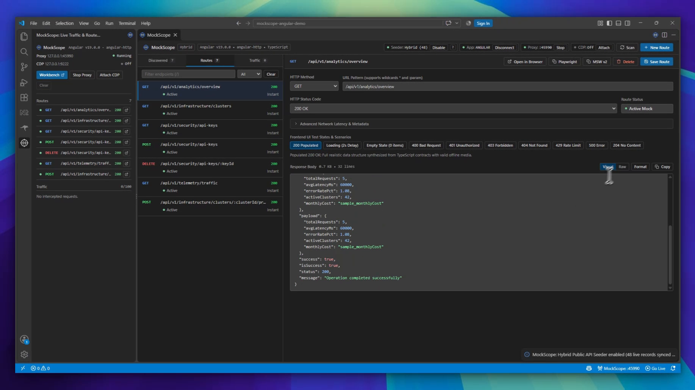
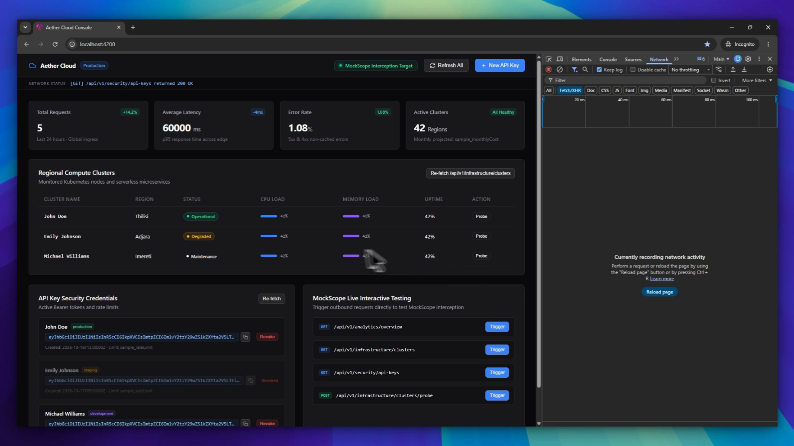
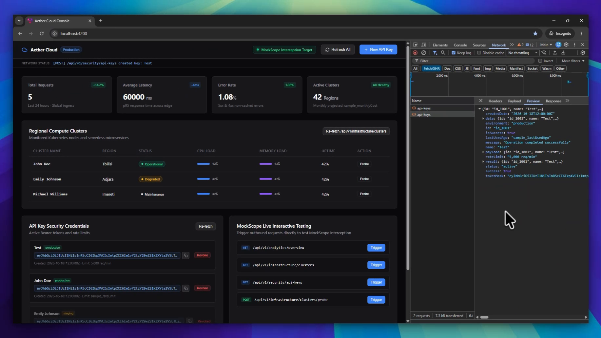

# MockScope

[](https://github.com/burdu-13/MockScope)
[](LICENSE)
[](https://code.visualstudio.com/)
[](SECURITY.md)

MockScope is a high-performance Visual Studio Code extension that bridges frontend development and unready backend APIs. It extracts HTTP call sites directly from TypeScript ASTs, synthesizes realistic mock payloads from generic return types, intercepts application network traffic over local loopback interfaces, and exports production-ready test mocks for Playwright and MSW v2.

***

## Overview

Modern web applications depend on typed backend contracts, yet frontend developers frequently face unbuilt endpoints, broken staging environments, or complex local setup requirements. 

MockScope eliminates these dependencies by analyzing your source code inside VS Code. Rather than relying on manually assembled JSON fixtures, MockScope automatically discovers HTTP signatures, evaluates their TypeScript interfaces, spins up a local loopback reverse proxy on `127.0.0.1:45990`, and configures your project dev server to route matching requests directly into synthesized scenarios.

***

## Quick Start (30 Seconds)

1. **Scan Call Sites:** Open any TypeScript or JavaScript file containing network calls (`fetch`, `axios`, TanStack Query, or Angular `HttpClient`). Inline CodeLens action triggers appear above each detected signature automatically.
2. **Launch Workbench:** Press `Ctrl+Alt+M` (macOS: `Cmd+Alt+M`) or click the `MockScope` status bar item to open the visual route table, traffic inspector, and scenario manager.
3. **Connect Frontend Dev Server:** Click `Connect` in the Workbench header to route application requests to `127.0.0.1:45990` via your dev server (Vite, Next.js, Angular, Nuxt), or click `Attach CDP` for zero-configuration browser interception.

***

## Visual Workflow Tour

### 1. AST Endpoint Discovery and 1-Click Proxy

MockScope scans the active workspace buffer without booting a full TypeScript compiler program on every keystroke. It identifies `fetch`, `axios`, TanStack `useQuery`, and Angular `HttpClient` invocations in under 3 milliseconds.

From the MockScope Workbench, developers can view all detected endpoints and initialize mock routing with a single click.



*The MockScope Workbench displays discovered API endpoints, active proxy status on `127.0.0.1:45990`, and the optional Hybrid Public API Seeder.*

***

### 2. Type-Driven Synthesis and Scenario Management

MockScope traverses TypeScript generics (`<T>`) up to three levels of recursion depth to generate structurally valid payloads. The Route Inspector allows instant switching between standard response scenarios without restarting dev servers:

* **200 Populated:** Fully seeded data structures conforming to TypeScript models.
* **Loading (2s Delay):** Simulates network latency to verify UI loading skeletons and spinners.
* **Empty State (0 items):** Empties collections to test fallback screens.
* **400 Bad Request / 401 Unauthorized / 403 Forbidden / 500 Error:** Validates frontend error boundaries and toast notifications.



*Route Inspector for `/api/v1/analytics/overview` showing scenario presets and synthesized JSON response payload.*

***

### 3. Zero-Backend Browser Interception

Once connected, your frontend web application runs in the browser against the local MockScope proxy. In the example below, an Angular enterprise console (`localhost:4200`) displays live charts, cluster nodes, and status indicators powered entirely by MockScope synthesis.



*Angular web application running on `localhost:4200` connected to MockScope with populated telemetry and metrics.*

***

### 4. Wire-Level DevTools Verification

Stateful mutations are handled directly over the wire. Creating a new record in the frontend triggers a real HTTP POST request that is intercepted, statefully recorded, and fulfilled with a typed 200 OK response visible in Chrome DevTools.



*Chrome DevTools Network inspection showing intercepted `POST /api/v1/security/api-keys` returning a typed JSON response.*

***

## Core Capabilities

### Ultra-Fast AST Scanning (< 3 ms)
MockScope evaluates open editor buffers using single-file TypeScript parsing (`ts.createSourceFile`). AST traversals are debounced to 300 ms on typing to guarantee zero typing latency on the main thread.

### Generic Return-Type Synthesis
By evaluating AST type arguments (for example, `http.get<AnalyticsOverview>('/api/analytics')`), MockScope synthesizes realistic mock data, respecting string patterns, numeric ranges, and nested object hierarchies while preventing circular recursion traps.

### Dual Wire Interception Modes
* **Local Loopback HTTP Proxy (`127.0.0.1:45990`):** An embedded reverse proxy with built-in CORS preflight negotiation, streaming delay simulation, and automatic framework forwarding file generation (e.g. Angular `proxy.conf.json`, Vite `server.proxy`).
* **Chrome DevTools Protocol (CDP) Bridge:** Direct wire interception utilizing `Fetch.enable` and `Fetch.fulfillRequest` for zero-configuration browser interception.

### 1-Click Test Exporter
Export any active scenario into copy-pasteable test specifications:
* **Playwright:** `await page.route('/api/**', async route => ...)`
* **MSW v2:** `http.get('/api/**', () => HttpResponse.json(...))`

### Bounded Memory Footprint (< 35 MB)
Traffic logs are managed via a fixed-size circular ring buffer (FIFO: maximum 100 entries). Memory usage remains strictly bounded, preventing IDE degradation during long coding sessions.

***

## Architecture

MockScope is structured according to Feature-Sliced Architecture (FSA) principles. Feature slices maintain vertical isolation, and engine logic remains completely decoupled from VS Code APIs:

```
src/
|-- app/                      # Extension lifecycle & composition root (extension.ts)
|-- features/                 # Vertical domain slices (isolated)
|   |-- ast-call-analyzer/    # Non-blocking TypeScript AST parsing (<3ms)
|   |-- type-synthesizer/     # Generic return-type mock generator
|   |-- runtime-proxy/        # Local loopback HTTP reverse proxy & route table
|   |-- cdp-bridge/           # Chrome DevTools Protocol Fetch controller
|   |-- codelens-provider/    # Inline editor CodeLens presentation layer
|   |-- project-connector/    # Automated dev-server proxy configuration
|   |-- framework-detector/   # Angular, Vite, Next.js, and Nuxt project detection
|   `-- test-exporter/        # Playwright and MSW v2 code generator
`-- shared/                   # Domain-agnostic primitives
    |-- kernel/               # Circular ring buffer, events, credential sanitizer
    |-- cdp/                  # Low-level loopback WebSocket client
    `-- ui/                   # Shared Webview view provider & strict CSP nonces
```

***

## Command Palette Reference

| Command Identifier | Title | Context |
| :--- | :--- | :--- |
| `mockscope.openWorkbench` | MockScope: Open Workbench | Global / Editor Title |
| `mockscope.openDashboard` | MockScope: Open Traffic & Route Dashboard | Global / Explorer |
| `mockscope.startProxy` | MockScope: Start Local Mock Proxy | Global |
| `mockscope.stopProxy` | MockScope: Stop Local Mock Proxy | Proxy Running |
| `mockscope.connectProject` | MockScope: 1-Click Connect Project Dev Server | Workspace Open |
| `mockscope.disconnectProject` | MockScope: Disconnect Project Dev Server | Project Connected |
| `mockscope.attachCdp` | MockScope: Attach Browser CDP Bridge (Auto-Launch) | Global |
| `mockscope.attachCdpCustom` | MockScope: Attach CDP with Custom Port... | Global |
| `mockscope.detachCdp` | MockScope: Detach Browser CDP Bridge | CDP Attached |
| `mockscope.mockCall` | MockScope: Mock API Call | CodeLens / Editor |
| `mockscope.copyPlaywrightSpec` | MockScope: Copy Playwright Route Spec | Inspector / Context |
| `mockscope.copyMswHandler` | MockScope: Copy MSW v2 Handler | Inspector / Context |
| `mockscope.openInBrowser` | MockScope: Preview Mock Endpoint in Browser | Inspector / Context |

***

## Keyboard Shortcuts

| Shortcut | Command Identifier | Description |
| :--- | :--- | :--- |
| `Ctrl+Alt+M` (macOS: `Cmd+Alt+M`) | `mockscope.openWorkbench` | Open or focus the MockScope Workbench |

***

## Configuration Settings

MockScope contributes configurable settings under the `mockscope` namespace:

| Setting Key | Type | Default | Description |
| :--- | :--- | :--- | :--- |
| `mockscope.proxyPort` | `integer` | `45990` | Loopback port for the embedded local HTTP mock proxy (binds to 127.0.0.1 only). |
| `mockscope.cdpPort` | `integer` | `9222` | Port used for Chrome DevTools Protocol (CDP) wire interception (binds to 127.0.0.1 only). |
| `mockscope.enableCodeLens` | `boolean` | `true` | Show inline MockScope action CodeLenses directly above detected API calls in code editors. |

***

## Frequently Asked Questions

### Does MockScope modify my production source code?
No. AST call analysis operates strictly in-memory on open editor buffers. When using 1-Click Connect, MockScope configures local dev-server proxy configuration files (such as `proxy.conf.json` or `vite.config.ts` proxy entries) with clear demarcation comments. Source application logic remains completely untouched.

### Does any telemetry or data leave my machine?
No. MockScope enforces a strict zero-trust client sandbox. All proxy listeners and CDP WebSocket connections bind strictly to `127.0.0.1`. The extension contains zero outbound telemetry calls and is 100% offline and air-gap compatible.

### Do I need an OpenAPI or Swagger specification to get started?
No. MockScope synthesizes mock structures directly from TypeScript return type generics (such as `<T>` in `http.get<UserProfile>('/api/profile')`). If OpenAPI or Swagger specifications exist in your workspace, MockScope automatically detects them and extracts additional endpoint definitions.

### How does MockScope compare to MSW or Playwright mocking?
MockScope provides interactive, visual, zero-boilerplate mocking during feature development without writing mock handlers or installing npm packages. Once your feature is complete, MockScope exports production-grade MSW v2 handlers and Playwright route specifications with a single click.

***

## Security and Zero-Trust Client Sandbox

MockScope operates strictly within a zero-trust local model:

* **Strict Local Loopback (`127.0.0.1`):** All proxy listeners, WebSocket connections, and CDP bridge interfaces bind strictly to `127.0.0.1`. MockScope never listens on `0.0.0.0` or public network adapters.
* **Zero Outbound Telemetry / Zero Egress:** The extension makes no external network requests, collects no telemetry, and operates 100% offline in air-gapped environments.
* **Transient Credential Handling:** Authorization headers, Bearer tokens, and session cookies captured in memory are sanitized by the kernel ring buffer and are never persisted to disk or workspace files.
* **Strict Webview Content Security Policy:** Webviews enforce cryptographic per-session nonces (`'nonce-${nonce}'`), preventing script injection and disallowing inline styles or external CDN resources.
* **No Dynamic Shell Execution:** Banned functions include `child_process.exec`, `child_process.execSync`, `eval()`, and `new Function()`.

***

## Development and Verification

### Prerequisites
* Node.js v20.x or higher
* npm v10.x or higher

### Build and Test Commands

```bash
# Install dependencies
npm install

# Verify TypeScript compilation and type contracts
npm run typecheck

# Run Vitest test suite (91 unit and integration tests)
npm test

# Run test coverage audit (>85% enforced)
npm run test:coverage

# Build minified production bundle (<350 KB target)
npm run build
```

***

## License

This project is licensed under the [MIT License](LICENSE).
